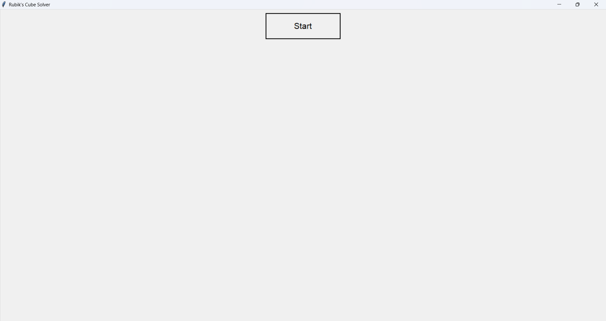
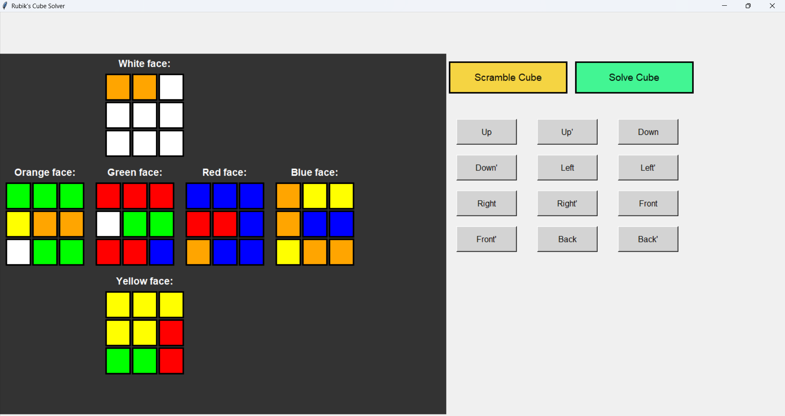
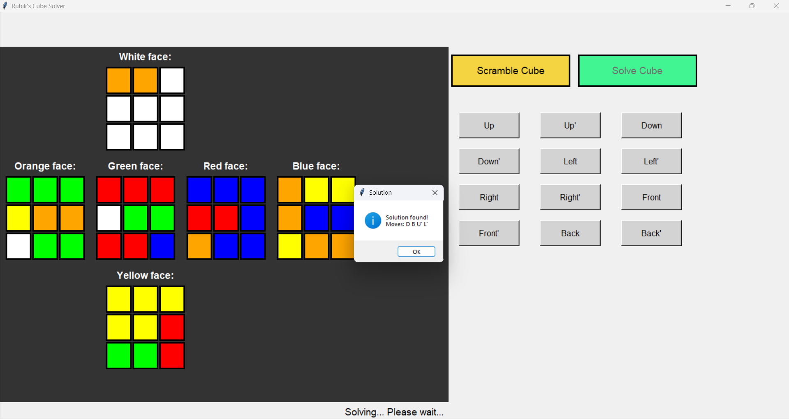
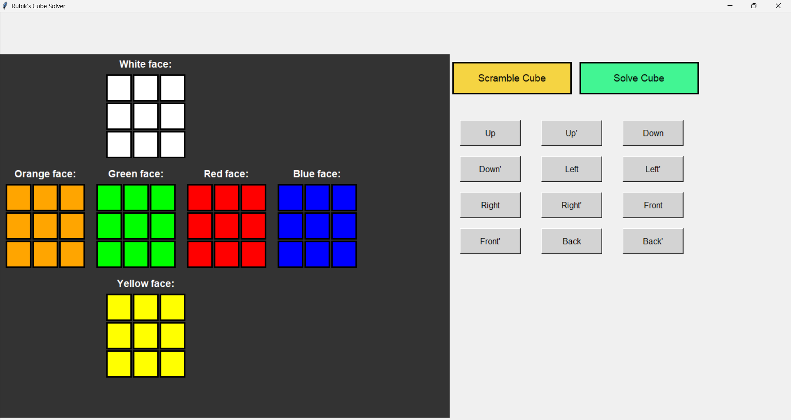

# Rubik's Cube Solver (Python GUI)

A graphical Rubik's Cube Solver implemented in Python. This project features an interactive 2D interface where users can manually rotate faces, scramble the cube, and watch an AI search algorithm find the solution in real-time.

## The Algorithm (IDDFS)

The core of the solver uses  **Iterative Deepening Depth-First Search (IDDFS)** .

* **Why IDDFS?** It combines the space-efficiency of Depth-First Search (DFS) with the optimality of Breadth-First Search (BFS). It finds the shortest possible sequence of moves to solve the cube.
* **Threading:** The search algorithm runs in a separate thread (`threading` module) to ensure the GUI remains responsive and doesn't freeze during complex calculations.

## Features

* **Interactive GUI:** Built entirely with Python's built-in `tkinter` library.
* **Manual Controls:** Rotate any face (U, U', D, D', L, L', R, R', F, F', B, B') manually.
* **Scramble Function:** A built-in button to randomly scramble the cube for testing.
* **Real-time Updates:** The UI updates dynamically as the algorithm searches for the solution.

## Project Structure

* `main.py`: The complete source code (UI, Logic, and Algorithm).
* `README.md`: Project documentation.

## 🚀 How to Run

1. Clone the repository:
   git clone [https://github.com/Awlishahnazi/Rubiks-Cube-Solver.git](https://github.com/Awlishahnazi/Rubiks-Cube-Solver.git)
2. Navigate to the project directory:
   cd Rubiks-Cube-Solver
3. Run the application:
   python main.py

*(No external libraries are required. Only Python 3.x and Tkinter are needed).*

## Screenshots

When you **run** the python file, you see the **start section****:**

After pressing **start button**, you can see the **Cube status**, **buttons for movements**, **Scramble Cube button** and **Solve Cube button:**

This is the Scrambled version of the Cube **(After pressing the Scramble Cube button):**

And with pressing **Solve Cube Button** the cube will be solved**:**

**The final result:**

<!--  <--## 👨‍💻 Author

**Ali Shahnazi Bejarsari**

* [GitHub Profile](https://github.com/Awlishahnazi)
* [LinkedIn](https://linkedin.com/in/ali-shahnazi-678bba342)
* [Personal Portfolio](https://alishahnazi.ir/)
